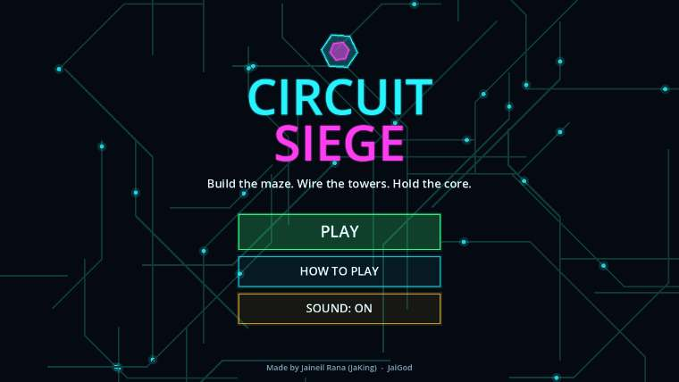
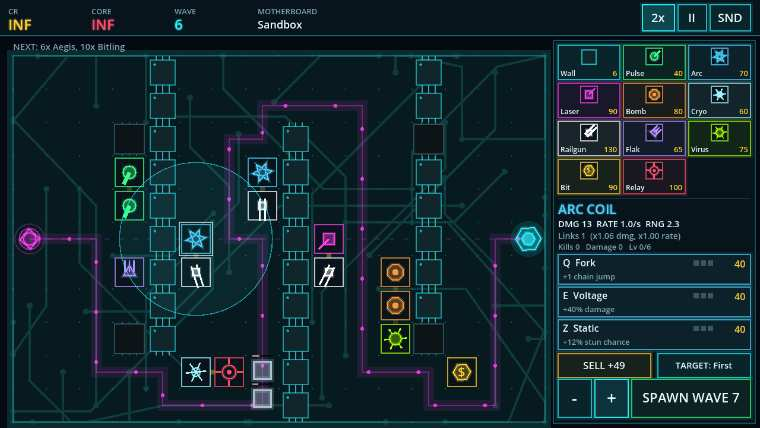
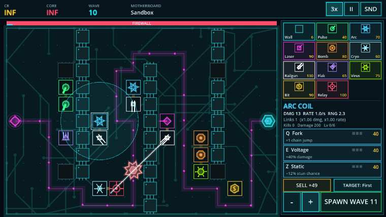
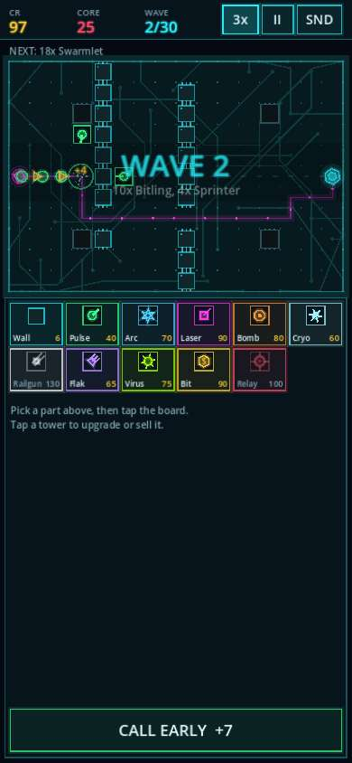

<div align="center">

# ⚡ CIRCUIT SIEGE ⚡

### Build the maze. Wire the towers. Hold the core.

A neon **maze-building tower defense** made in **Godot 4.3**, playable free in your browser on desktop and phone.

[](https://jaigod.github.io/circuit-siege/play/)

[](https://jaigod.github.io/circuit-siege/)
[](https://godotengine.org)
[](https://github.com/JaiGod/circuit-siege/actions/workflows/pages.yml)
[](LICENSE)
[](https://github.com/JaiGod)



</div>

---

## 📸 Screenshots

| Mazing + towers | Boss wave: FIREWALL |
|:---:|:---:|
|  |  |


<div align="center">

**Phone (390 px wide, touch)**



</div>

## 🎮 What is it?

Enemies pour out of the **magenta ports** and race to your **cyan core** across a circuit board. There is no fixed path: every wall and tower you place becomes part of the maze, and the enemies re-route **live with A\*** the moment you build. You can never fully seal the path, so the game is about making it as long and as deadly as possible.

## ✨ Features

- 🧭 **Live A\* path recalculation**: `AStarGrid2D` re-plans every ground enemy's route the moment you build or sell, and a placement that would block the core is refused.
- 🗼 **10 towers, 3 upgrade branches each**: Pulse Node, Arc Coil, Laser Diode, Bomb Capacitor, Cryo Fan, Railgun, Flak Array, Virus Injector, Bit Miner, and Relay Hub. Each branch has 3 levels with a cap of 6 levels per tower, so you have to specialise.
- 🔗 **Adjacency synergies**: neighbouring towers *link* (+6% damage per different neighbour, +5% rate per matching one), Relay Hubs buff everything in reach, and 5 named combos unlock bonuses: *Superconductor, Dirty Bomb, Focused Array, Crossfire, Overmine*.
- 👾 **10 enemy types**: Bitling, Sprinter, Ironclad (armor), Aegis (shield), Swarmlet, **Drone (flying, ignores the maze)**, Splitter, Blinker (teleports), Patcher (heals), and Hive Core (spawns swarms).
- 💀 **3 bosses** on waves 10 / 20 / 30: FIREWALL, KERNEL PANIC, and SINGULARITY, each with a boss health bar.
- 🗺️ **5 boards**: Motherboard, Twin Bus, Chip Socket, Crossfire, and Serpent Trace, with multi-spawn lanes and pre-etched chips.
- 🕹️ **4 modes**: a **30-wave Campaign** with up to 3 stars per board, **Endless**, **Sandbox** (infinite credits, pick any wave), and **Challenge** (Iron Grid, No Walls, Overclock Rush, Glass Core).
- ⏩ **1x / 2x / 3x speed**, early wave calls for bonus credits, pause, and targeting modes (First / Strong / Close).
- 🔊 **All audio is synthesised in code** (no sound files), and **all art is drawn procedurally** (no image assets).
- 💾 Best waves and stars are saved locally (`user://`, which maps to IndexedDB on the web).
- 📱 Responsive layout: a landscape side panel on desktop and a portrait bottom panel on phones, with full touch support.

## 🕹️ Controls

| Action | Mouse / touch | Keyboard |
|---|---|---|
| Pick a tower / wall | Tap a part in the panel | `1`–`0` towers, `W` wall |
| Build | Tap or click the board (drag to paint walls) | – |
| Select a tower | Tap it | – |
| Upgrade branch | Tap the branch button | `Q` / `E` / `Z` |
| Sell / cycle target | Panel buttons | `S` / `T` |
| Start or call a wave | **START WAVE** button | `Space` / `Enter` |
| Speed 1x→2x→3x | **1x** button | `F` |
| Pause / mute | **II** / **SND** | `P` or `Esc` / `M` |
| Cancel build | Right-click | `Esc` |

## 🛠️ Tech stack

- **Godot 4.3** with GDScript and the **Compatibility (GL) renderer**, so the web export runs everywhere.
- **Web export** with threads disabled, so it runs on GitHub Pages without COOP/COEP headers.
- **GitHub Actions**: a headless smoke test, then a Web export, then a deploy to Pages (`barichello/godot-ci:4.3`).
- A plain HTML/CSS landing page with a procedural canvas background.

## 📁 Project structure

```
circuit-siege/
├── project.godot            # Godot 4.3 config (gl_compatibility)
├── export_presets.cfg       # Web preset (threads off)
├── main.tscn                # single root scene
├── scripts/
│   ├── data.gd              # towers, enemies, maps, wave generator, challenges
│   ├── sim.gd               # deterministic simulation: A* grid, combat, synergy
│   ├── main.gd              # game states, input, layout, save/load
│   ├── art.gd               # all procedural drawing: board, towers, enemies, UI
│   └── sfx.gd               # synthesised sound effects + music
├── tests/
│   ├── smoke.gd             # headless bot that plays every board and mode
│   └── SmokeTest.tscn
├── web/index.html           # landing page (served at /)
├── docs/screenshots/        # README / landing images
└── .github/workflows/pages.yml
```

The game is served at **[/play/](https://jaigod.github.io/circuit-siege/play/)** and the landing page at **[/](https://jaigod.github.io/circuit-siege/)**.

## 🚀 Run locally

1. Install [Godot 4.3](https://godotengine.org/download) (the standard build).
2. Open `project.godot` and press **F5**.
3. Run the headless test:
   ```bash
   godot --headless --path . --import
   godot --headless --path . res://tests/SmokeTest.tscn   # prints "SMOKE OK"
   ```
4. Export for the web (export templates must be installed):
   ```bash
   godot --headless --path . --export-release "Web" build/play/index.html
   cd build && python3 -m http.server 8000   # open http://localhost:8000/play/
   ```

## 📓 Development log

- **Simulation is separate from rendering.** `sim.gd` is pure data and logic with no nodes, so a headless bot can play all 30 waves on every board in CI within seconds. The renderer (`art.gd`) only reads its state.
- **Mazing with A\*.** `AStarGrid2D` (Manhattan heuristic, no diagonals) holds the solid cells. Before a placement is accepted, the cell is set solid temporarily and every spawn plus every live ground enemy must still reach the core. If any of them can't, the build is refused with a "Can't fully block the path!" message. Every live ground enemy is re-pathed from its current cell after each build.
- **Fliers.** Drones ignore the grid and fly straight to the core, which is why Flak Arrays (air-only splash) exist and why some towers are ground-only.
- **Forcing specialisation.** Three branches at three levels each would allow 9 levels, but the cap of 6 makes you choose. For example, a Railgun can go Slug + Pierce or Slug + Capacitor.
- **Synergy design.** The generic link bonuses reward clustering towers next to the maze, and the named combos give a reason to mix tower types. Stats are recomputed only when the board changes, not every frame.
- **Challenge: web audio.** Godot's web export without threads can't use some audio paths, so every sound is generated at startup into `AudioStreamWAV` buffers, which work in single-threaded mode.
- **Challenge: phones.** The layout switches to portrait when the viewport is taller than it is wide. The board takes the top 42%, the build panel sits underneath, and touch emulates the mouse.
- **CI:** the smoke test runs before the export, so a broken build never reaches Pages.
- **Beta tested on the live site ✅ (2026-11-05):** /play/ boots past the loading bar, a sandbox maze was built, waves were played at 3x, and the console showed no errors.

## 🔗 More from JaiGod

- 🏰 [All JaiGod games and projects](https://github.com/JaiGod?tab=repositories)
- 🛡️ [Bulwark TDS](https://github.com/JaiGod/bulwark-tds), another tower defense from the studio
- ⚡ [Voltline](https://github.com/JaiGod/voltline)

---

<div align="center">

Made by Jaineil Rana (JaKing) · part of [JaiGod](https://github.com/JaiGod)

</div>
